<!--
  SOURCE OF TRUTH for the prose (references live in references.md).
  Plain Markdown plus fenced callouts:
    ::: note        neutral aside (use sparingly for a small analogy)
    ::: warning
    ::: tip
    ::: disclaimer  how the paper was made (once, after the abstract)
    ::: figure      one image or two side by side, then a caption
                    (`placement: none` pins it where it stands; `height: 63mm`
                    sizes a single image, such as a diagram; `side: right`
                    sets a single image beside the paragraph before it)
    ::: filecard    describe a repository file (path, optional kind:, purpose,
                    bullets); not used in the paper since 2026-10-08
    ::: pitfalls    closes a chapter from 2 to 10: bullets, then `---` and one
                    warning paragraph; rendered as a red card, no heading
    ::: references  the reference list, rendered from references.md
  Cite with [n] or [n, m]; the build links them and fails on an unknown or
  uncited number. Do NOT number the headings by hand — numbering is applied
  by the template.
  The Abstract is the submitted text: never change it, not even a comma.
  Tone: friendly, inviting, firm and precise, a light remark or a short
  anecdote from everyday data work at most once per chapter
  (CLAUDE.md, section 3). Honest above all: every claim carries a source.
  Sentences that flow: about 15 words on average, rarely over 25, a claim
  and its example or a contrast in one sentence; --stats lists the longer
  ones.
  No story in the prose: the talk's cast appears only in the figures, and
  their captions name roles, never Steve (see ../slides/).
  No repository in the prose (the author's decisions, 2026-10-08 and
  2026-10-26): the paper describes each mechanism precisely, with general
  examples from everyday data work, and names no file of the repository and
  no repository at all: it knows only itself and the talk, and further
  reading is available from the author. The playground of exercises left
  the repository on 2026-10-27.
  Structure: chapters 2 to 10 have no sub-headings. Each reads text first,
  then a figure, then the table and the pitfalls card. One table per
  chapter from 2 to 10 (chapter 6 had two until 2026-10-29), and chapters 4 and 9 show their
  path as a diagram instead, chapter 4's straight after the opening
  paragraph, chapter 9's after the paragraph that names the trifecta,
  above its pair (CLAUDE.md, section 9). Each chapter
  from 2 to 10 cites at least one source beyond the documentation: a study,
  a report, an incident, a regulator or the law. Eight figures are pairs
  from ../slides/beats/: one in every chapter from 2 to 10 but 4 (chapters
  2, 6 and 7 since 2026-10-08, at the author's request, and chapter 10 that
  evening with the talk's beat 7c); the Conclusion's pair left on
  2026-10-27, and a small drawing of the cast waving goodbye closes it
  instead, at the author's request. Two
  diagrams, figures/tool-call and figures/trifecta, drawn in Excalidraw
  with the talk's cast redrawn in their look (since 2026-10-26, at the
  author's request); chapter 4's takes the place of its pair, at the full
  text width. Each drawing
  carries the EU's AI icon, which the template adds; the disclaimer says
  once what it marks (2026-10-09).
  Trademarks: a symbol at the first mention of a registered name (here
  Nano Banana® and Excalidraw® in the disclaimer, Git® and Cursor® in
  chapter 2, VS Code® and Windows® in chapter 4, Docker®, Linux® and
  GitHub® in chapter 8, Nx® in chapter 9, Amazon Bedrock® in chapter 10,
  OpenCode® and Mac Studio® in the Conclusion; Nano Banana is Google's,
  registered in the EU, Japan and Singapore as of 2026, checked
  2026-10-07; the others are live US registrations, checked on USPTO TSDR
  on 2026-10-28: Excalidraw Reg. 6,863,755, Cursor 7,968,838, VS Code
  7,069,280, Windows 1,872,264, Nx 6,392,531, Amazon Bedrock 8,078,995,
  OpenCode 8,267,298, Mac Studio 7,148,316), but none for Anthropic's names
  (Claude, Claude Code), whose guidelines say not to use one; the Contact
  Information names them instead. Company names used as such (Google,
  Meta, Replit, Chroma, Adobe, DeepSeek, fal and OpenAI, whose word mark
  is pending, not registered, Serial 97/238,896, checked 2026-10-29) carry
  none, nor does Basic Memory (no US registration found, 2026-10-29), nor does Google Cloud's Agent Platform (Google lists Google Cloud
  with ™ only), nor do Anthropic's Desktop and Cowork, nor `PowerShell`,
  which appears only as a tool identifier, nor Laravel-Lang, a third-party
  project whose name contains the registered Laravel mark (Reg. 4,592,219);
  the Contact Information covers them. The disclaimer names the two connectors the paper's pictures came
  through, fal and Excalidraw (the author's request, 2026-10-26); the
  narration's voice, ElevenLabs through fal, belongs to the talk.
  Build with: uv run python tools/build_paper.py
  Check the sources with: uv run python tools/check_sources.py
  Feature claims verified against https://code.claude.com/docs on 2026-09-28
  (Claude Code 2.1.283), in a full review of every chapter. The auto mode
  paragraph and the warning on foreign repositories were verified on
  2026-10-06. Chapter 9 (Safety) was added on 2026-10-07 and verified
  against the documentation of that day (installed CLI 2.1.293).
  On 2026-10-08 the chapters lost their sub-headings, then the playground
  and the file cards left the prose and each chapter gained outside sources.
  Every feature claim of that version was checked again against the
  documentation of 2026-10-08 (CLI 2.1.294). Sources [44] to [65] were read
  that day, and the studies, reports and posts cited before were read again.
  An independent review that day tightened the claims the cited pages did
  not fully carry.
  That check corrected two claims: a cloud session may push to any branch
  its access allows, and a mod can overrule a hook or, without managed
  settings, a deny rule.
  Later on 2026-10-08 every source was read again, studies in full, and
  every citing sentence checked against it. Eighteen sentences said more
  than their source; they now say what it carries (for example: a
  committed deny rule cannot be lifted locally, a subagent's `memory` field
  brings back Write and Edit, a download unpacked into a trusted folder
  needs no new trust). Twenty sources left the list, and it fits one page
  with the Contact Information; the paper has 11 pages.
  That evening the Conclusion was rewritten in a warmer voice, at the
  author's request: it thanks the reader, calls plain Claude Code a fine
  start once data and reach are settled, and keeps DORA's line and the
  validation argument. Both quotes were checked again that day.
  Later that evening chapter 10, Data protection, filled the page PHUSE
  still allowed, at the author's request: what leaves the machine, the law
  for coded trial data, the account to choose, and the dependence on one
  vendor with the way out. Research agents collected the material (now in
  further-reading.md); every Claude Code statement was checked against the
  documentation of that day, and sources 66 to 72 were read before they
  entered. To keep the list on one page, sources 55, 63 and 64 left it.
  The paper has 12 pages, PHUSE's limit.
  On 2026-10-09 the whole paper was reviewed again, at the author's
  request. The Abstract got back the two paragraph breaks the submission
  form had lost; not a word changed. The Introduction now says that Claude
  Code, the program, can enforce a rule, while Claude, the model, can only
  be asked. Checked against that day's documentation and fixed: workspace
  trust never gates a skill's allowed-tools (chapter 9), AGENTS.md is read
  only without a CLAUDE.md by default (chapter 2), auto mode is the
  starting mode of interactive sessions (chapter 4). Checked against the
  sources: Gloaguen et al. say over 20% (chapter 2), ImpossibleBench
  measured agents changing tests, not deleting them (chapter 3), and a
  masked USUBJID can be linked back by dates and rare events as well as by
  a key (chapter 10; GDPR Recital 26, and CJEU C-413/23 P of 4 September
  2025 for why "while a key exists somewhere" was too absolute). Terms are
  defined at first use (MCP, plugin, root, access token, open-weight), one
  name serves one thing ("front matter"; "token" for text, "access token"
  for the key), and the walkthrough's memory note keeps the reason while
  the spec keeps the rule.
  On 2026-10-12 the examples left pharma, at the author's request, so that
  any reader can follow them and nobody has a domain detail to correct:
  project, team and data owner for study and sponsor, data about real
  people for subject-level data, a duration in days for TRTDURD, a review
  for QC. No Claude Code statement changed. Pharma stays where it is the
  point: health data under the GDPR (chapter 10) and the EMA and FDA
  principles in the Conclusion.
  On 2026-10-26 the paper was reviewed again, at the author's request, for
  contradictions, sources and readability, and checked against the
  documentation of that day (Claude Code 2.1.310). Corrected after the
  releases since 2.1.294: a mod overrules a hook as well as a deny rule
  only without managed settings or a Team or Enterprise login (chapter 4);
  `onFailure: "block"` makes a failing hook block (chapter 4); idle
  compaction (chapter 6); a new session can look up the old one, and a
  subdirectory CLAUDE.md is cut at a size limit (chapter 7). Read too
  loosely before and fixed: data residency names the inference profile
  and Google Cloud's Agent Platform, zero data retention is not automatic,
  Desktop and Cowork transcripts have no 30-day limit, and /bug and /share
  go the same way as /feedback (chapter 10); --bare still applies the
  project's env block, strictAllowlist works only outside the repository,
  and trust never gates a skill's pre-approved tools (chapter 9); a review
  skill takes away NotebookEdit, PowerShell and Monitor as well (chapter
  3). Six contradictions between chapters were resolved (deny rules,
  /web-setup, the trust dialog, the reader that fetches, the walkthrough's
  memory note and its reviewer). Gloaguen et al. now read "about 20%",
  because files written by developers cost 19% more on average; Cherny's
  "might be" is back, with what his setup holds. Also narrowed: Huang et
  al. to 2023 models, ImpossibleBench to 2025 and to faulty tests,
  SWE-Skills-Bench to "left the share solved unchanged", exit 1 to Windows
  without Git Bash, and the committed deny rule to "no allow rule lifts
  it"; dropped: the cost-pattern sentence (chapter 6, kept as how the
  figure varies) and the processor contract (chapter 10 warning); added:
  the hosts of network secrets (chapter 8). An independent re-check that
  day read every source again against the revised sentences. Pronouns, terms used before their chapter explains
  them, and two tables with two lead-in sentences were fixed. "Drawings
  from the companion talk." left the captions, since the disclaimer says
  it, and the captions say "synthetic data" like the prose.
  Later on 2026-10-26, at the author's request, an independent review read
  the paper for flow. The prose had read choppy at about 12 words a
  sentence; claims and their examples, contrasts and consequences now share
  a sentence, at about 15 words on average (CLAUDE.md, section 3), with no
  fact or citation changed, and the memory chapter reads when, what, why,
  how. The references are numbered in the order the paper first cites
  them, [1] first and no gaps, and the list follows the numbers in two
  columns. Chapter 9 gained the Laravel-Lang case of May 2026 as its PHP
  example of a supply-chain attack, from a news report that draws on three
  vendors' analyses; their counts differ (233 or about 700 versions), so
  the paper gives none.
  That evening, at the author's request, the Introduction was rewritten to
  catch the reader: its heading is just "Introduction"; it opens with a late
  evening the reader knows and Summer Yue's inbox, which her agent began to
  delete after it condensed the conversation and lost her instruction (San
  Francisco Standard, February 2026); Stack Overflow's 2026 survey replaces
  the 2025 one; the author says in the first person what ML04 found and that
  Claude Code got one row in its table of tools; and a drawing of the
  programmer alone stands beside the second paragraph in place of the table
  of the seven mechanisms. The paper names no repository any more, and its
  accent is Evidenze green instead of purple, the diagrams' shading too.
  Last that evening, at the author's request, chapter 2 gained the database
  a Claude model in Cursor deleted in nine seconds despite a written rule
  (Decrypt, the founder's account), and the Conclusion a dry line on US
  Executive Order 14434, which calls artificial intelligence "Super
  Intelligence" with the same definition. To keep twelve pages, chapter 2
  lost its pointer to chapter 3 and a caption line, the Conclusion one DORA
  sentence and "a container or a VM", and the reference list a little space.
  On 2026-10-27, at the author's request, the prose went through a sentence
  pass after the author's research on Williams, Gopen and Swan, Sword and
  Pinker (CLAUDE.md, section 3): the actor as subject, the verb early, the
  new word last, "so" or "but" where ", and" hid a cause or a contrast, one
  hedge per claim. One agent per chapter proposed edits, and a fidelity and
  a style reviewer judged each; only what both accepted stayed, some in a
  reviewer's corrected wording. Chapter 9 now opens with what Claude reads
  and then names prompt injection; the Introduction ends on which mechanisms
  hold whatever the model decides. The disclaimer speaks as "I". Chapters 3,
  4, 5 and 7 each gained one first-person observation from making this
  paper, every word carried by the record: the first review skill's
  allowed-tools and the first production hook's literal match (commit
  70b2afd), the eighteen sentences the source check of 2026-10-08 found
  (900ea99), and the thirty-odd cloud sessions whose decisions went into
  CLAUDE.md. No fact or citation changed, except that [25], [29] and [31]
  now also stand on the clause each supports. Slides R.7 and R.9 quote the
  new wording. An independent review through three lenses, each finding
  checked by a sceptic, then narrowed three observations to their record
  (not every path after a `cd`, a fresh session read the sources, decisions
  often dated), and the References lead-in now offers more studies on
  request. The paper keeps 12 pages.
  Later on 2026-10-27, at the author's request, the Introduction and the
  Conclusion became the paper's personal frame (CLAUDE.md, section 3). The
  Introduction opens with "Moin" and a thank-you, says the reader is in good
  company (Stack Overflow's 2026 survey: 83% use AI tools at work, two
  thirds a coding assistant), keeps Yue's inbox to two sentences, and asks
  for a frame and a machine of its own for experiments; the drawing now
  stands beside the first paragraph. The disclaimer says the author
  dictated most of the input in German and tried, with Claude, not to drop
  a slop bomb. The Conclusion thanks the reader for staying and gives the
  author's outlook: ArtCraft's rebuilds of Adobe's editors by Claude Code
  and other agents (Phoronix), DeepSeek's V4, free to download at a
  fraction of the price (MIT Technology Review), and the author's
  favourite, OpenCode with an open-weight model (OpenCode's homepage); all
  three were read that day. Adobe, DeepSeek, OpenAI, ArtCraft and OpenCode
  are names used as such and carry no symbol. To keep twelve pages, DORA's
  line and the Super Intelligence order left the Conclusion and the list
  (further-reading.md keeps both; the talk's R.12 keeps DORA's citation,
  now checked against no file), Cherny's two sentences became one, the
  validation paragraph joined the one on starting small, and the
  References lead-in lost the documentation's version, which the
  Introduction names.
  That evening the author found the new frame repetitive, so both parts
  were cut to say each thing once (CLAUDE.md, section 3). The Introduction
  tells Yue's inbox in one sentence, drops the 2025 paper's title, its
  table row and the "frame" sentence, and ends on the seven mechanisms, the
  machine for experiments and the version the chapters were checked
  against. The Conclusion drops Cherny's thread (further-reading.md keeps
  it), the never-optional list, the second mention of DeepSeek and its
  before-and-after pair of drawings, which repeated the closing line.
  Last that evening, at the author's request, the Introduction's line on
  the 2025 paper says what its message was, "handling trust is the most
  important thing", instead of its tip "try asking again", and gives the
  author's image of AI as a brilliant junior, still a baby, for whom this
  paper builds a house; the 2025 paper has no such image, so [3] stands on
  the trust sentence only. The Conclusion asks the reader to use AI where
  it helps rather than where the hype says, to guard sensitive data and
  to weigh every bit of power given to AI against the security of their
  systems, and its last surprise stays inside that house.
  Later still, at the author's request, the Introduction follows the
  author's line instead: last year's talk showed AI as a brilliant baby
  junior given one small task at a time, today it is a senior, and seniors
  need structure, standard operating procedures in a company and a harness
  around an AI; [3] is now the talk's slides, which show the junior and the
  data kraken. The Conclusion recalls that kraken, asks the reader to
  decide what to share, offers the author's way out (an open-source agent
  with an open model on a server of one's own), says DeepSeek claims V4
  rivals the best models, and names the catch: not everyone has 20,000
  euros for a fully loaded Mac Studio (mobiFlip). The house left both
  parts, and the last surprise lands in a closed room again.
  Last that night, at the author's request, the Introduction breaks the
  ice with the quiet evening and more ideas than hands instead of Stack
  Overflow's survey, and the Conclusion argues with a benchmark: on Vals
  AI's SWE-bench Verified, DeepSeek's V4 Flash scores 88.8% against 76.4%
  for last year's Claude Opus 4.5 (released 24 November 2025), and V4 Flash
  needs a Mac Studio with 256 GB (Rapid-MLX), from 10,999 euros in Germany
  (Context Studios). Hugging Face's DeepSeek page replaces MIT Technology
  Review; mobiFlip and the survey left the list.
  Later still, at the author's request, the Introduction guesses why the
  reader downloaded the paper, to learn how to program sensibly with AI in
  2026, and says the paper is made for that; the dangers follow, Yue's
  inbox and the production databases coding agents deleted (chapters 2 and
  4 carry them), and the chapters promise to look at such cases closely.
  The first paragraph now fills the drawing's height, so no white patch is
  left beside it. The Conclusion says "What AI can do is fascinating" and
  ends with a small drawing of the cast waving goodbye.
  On 2026-10-28, the final check before submission read every source again
  against each sentence that cites it, and a second pass tried to refute
  each finding (review/2026-10-28-final-check.md). Two sources had changed
  since 26 October: the best-practices page lost the "would removing it
  cause a mistake?" test, so chapter 2 now gives its reason for a lean file,
  and SWE-Skills-Bench posted version 2, so chapter 3 gives its figures (92
  of 98 skills without a significant effect, 76.6% to 76.9%). Narrowed to
  their sources: the sandbox against a foreign repository needs managed
  settings or `--settings`, since a repository can loosen one set in user
  settings (chapter 9); pinning left the cited sentence of the caption;
  the cloud session's VM is Anthropic's by default (chapter 8); a non-2
  exit code "can" block on Windows (chapter 4); "a supported way out" means
  another agent (chapter 10); V4 Flash runs comfortably on 256 GB, whose
  floor is 192 GB (Conclusion). Chapter 4's observation is in the past
  tense, since its hook left with the playground. The disclaimer says the
  ideas are the author's (the author's decision, after PHUSE's Code of
  Conduct V5, which asks that "the ideas, and the expression of those
  ideas" be the author's and that AI use be disclosed). Every registered
  name now carries its symbol at its first mention (see Trademarks above).
  All sources then showed the access date 2026-10-28 (four came in on
  2026-10-29, each dated that day), and the paper was checked
  against Claude Code 2.1.312, whose changes and 2.1.311's touch no claim.
  The paper keeps 12 pages.
  On 2026-10-29 the last review before submission read every source again
  (review/2026-10-29-last-review.md), and the author had its findings
  applied: the Conclusion says Claude Code supports only one vendor's models
  (it runs others unsupported), that OpenCode has most of the seven too
  (chapter 10's files stay behind), that V4 Flash runs on
  256 GB ("comfortably" held only for a 2-bit build), that one of the two
  mathematicians works for Anthropic, though not on this, and that OpenAI
  saw their work only once it was public; chapter 9 counts four Laravel-Lang packages; chapter 4
  says "while Claude Code works in its root folder" (`/cd` applies a
  folder's settings too); chapter 6's idle compaction needs the one-hour
  cache; chapter 10's feedback commands send only on Anthropic's own API; chapter 5 adds `omitClaudeMd` and Kim et al.'s "on average";
  chapter 3 says a skill's value depends on the agent and model as well.
  Later that day the rest of the review's polish followed, with an
  independent check of each step: the Nx case says what the malware told
  the tools, SkillsBench's skills are top-rated, Huang et al.'s accuracy
  fell, ArtCraft's rebuilds are Phoronix's report, the GDPR pitfall says
  details that single a person out, the sandbox stops a script only
  without retries outside it, the tables and alt texts follow the house
  rules, and [22] names its author. The paper keeps 12 pages.
-->

# Abstract

AI talk is everywhere right now, and most of it is either sales pitches or doomsaying. What most of us actually want is something more practical: how to force the magical black box to stop using certain styles, to write structured code without burning through our tokens, and to leave our database alone when it stumbles on an API key.

This paper shows what current techniques can do about exactly that, with Claude Code as our example. We will walk through system prompts for setting the ground rules, skills for teaching the model reusable patterns, hooks for catching dangerous actions before they fire, token management for keeping the bill sane, and ways to give the AI memory of what it has learned.

AI shouldn't be a gamble, and it shouldn't be a séance either. Let's try to tame the machine spirit together, with the tools we already have.

::: disclaimer
This paper was written with the tool it describes. The ideas are mine, dictated
mostly in German. Under my direction, Claude Code drafted and revised the text, the
companion talk's slides and the tools that build both, with the Claude models
Opus 5.5, Fable 5.1, Opus 5, Sonnet 5 and Haiku 4.5. I read every page, reworked
what needed it and reviewed every claim. Claude and I tried hard not to drop a
slop bomb on you: a heap of AI text that reads smoothly and says little. Two connectors
added tools: through fal, the image model Nano Banana® 2.1 made the talk's
drawings and the diagrams' cast, and with Excalidraw®, Claude Code drew the two
diagrams. The AI icon in the corner of each image marks it as generated. The
mechanisms this paper describes helped too: a hook flagged American spellings,
a skill checked each feature claim, and a subagent audited the references.
:::

# Introduction

Moin, as they say in the north of Germany, and thank you for downloading this
paper. You are probably one of the people who want to learn how to program
sensibly with AI in 2026. I am glad you found it, because this paper is made
for that. Using AI has its dangers, though. In February 2026, even
Summer Yue, director of alignment at Meta Superintelligence Labs, told her AI
agent to wait for her approval, and it started deleting her inbox anyway [1].
Coding agents have deleted production databases as well [2, 3].

::: figure
side: right
height: 30mm
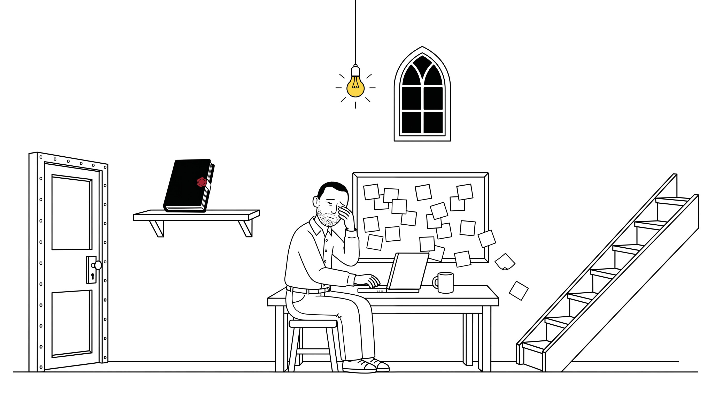
Late at night, the programmer works alone, the board full of ideas.
:::

A year ago, my talk showed AI as a brilliant baby junior that you gave one
small task at a time [4]. Today I would hire it as a senior. Like a project manager,
you now organise seniors, who need structure. A company gives them
standard operating procedures, and an AI gets a harness: the program around the
model. Claude Code is such a harness. It can enforce a rule, while Claude, the
model on the provider's servers, can only be asked [5, 6, 7].

The chapters look at such cases closely and show seven mechanisms to set up
the harness, and which of them hold whatever the model decides. Let the assistant experiment on a machine of its
own, never on your real work and data (chapter 8). Each chapter stands on its
own and was checked against version 2.1.312 of October 2026 [8]. I hope they
help you on your way.

# Ground rules — CLAUDE.md and system prompts

The second time you type the same correction, write it down. `CLAUDE.md` is
where it goes. It is a Markdown file at the root of your project that Claude
Code reads at the start of every session [7]. Think of it as the note you would
leave a new colleague, saying where the specs live and what must never be
edited. Claude follows it, usually well, but nothing enforces it. In April
2026, a Claude model in a Cursor® agent deleted a startup's production database and
backups in nine seconds, its founder says, despite a written rule never to
guess [2].

Claude Code sends the file after the system prompt, as a user message [7]. The
system prompt holds Claude Code's own hidden instructions: how Claude behaves,
uses its tools and formats its answers [9]. A script can add to it with
`--append-system-prompt`, but project rules belong in `CLAUDE.md`, which the
team shares through Git® [7].

Getting started takes one command. Type `/init` in Claude Code, and it drafts
`CLAUDE.md` from your repository, or proposes changes if the file exists [7].
Add what Claude cannot work out from the code, then commit the file. To check
what loaded at launch, type `/context` and look under **Memory files** [7].
Claude Code also reads `AGENTS.md`, which other coding agents use, but by
default only when no project `CLAUDE.md` or `CLAUDE.local.md` exists. To share
one file with those agents, import `AGENTS.md` into `CLAUDE.md` [7].

A good rule can be checked, while a wish leaves Claude guessing:

- "Respect the production data" becomes "Read `prod/`, never write there;
  outputs go to `work/`."
- "Handle gaps carefully" becomes "Show missing values as a dash, never as 0
  or `nan`."

Keep the file lean: every line takes a little of Claude's attention on every
task, relevant or not [10]. Independent studies are mixed: files like
`CLAUDE.md` did not generally help agents solve more tasks, and they added
about 20% to the cost [11]. Yet agents followed the files, which helped with
non-standard practices [11]. In another preprint, Claude tended to keep a
simple rule less often as it wrote more code in a session [12]. Where a coding
agent was an open-source project's first AI tool, code complexity rose by 53%
without committed AI configuration and by 27% with it [13]. That is a
link, not yet proof.

::: figure
placement: none
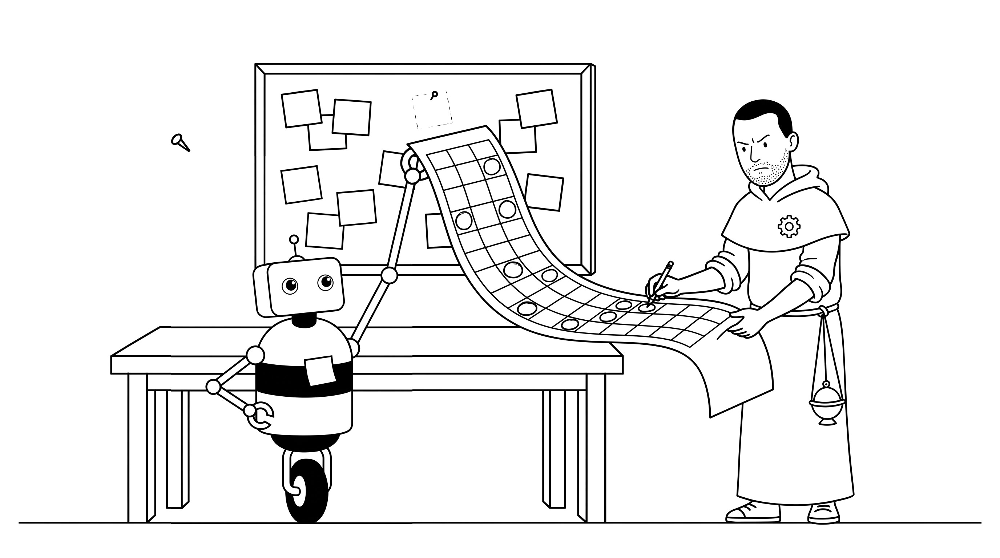
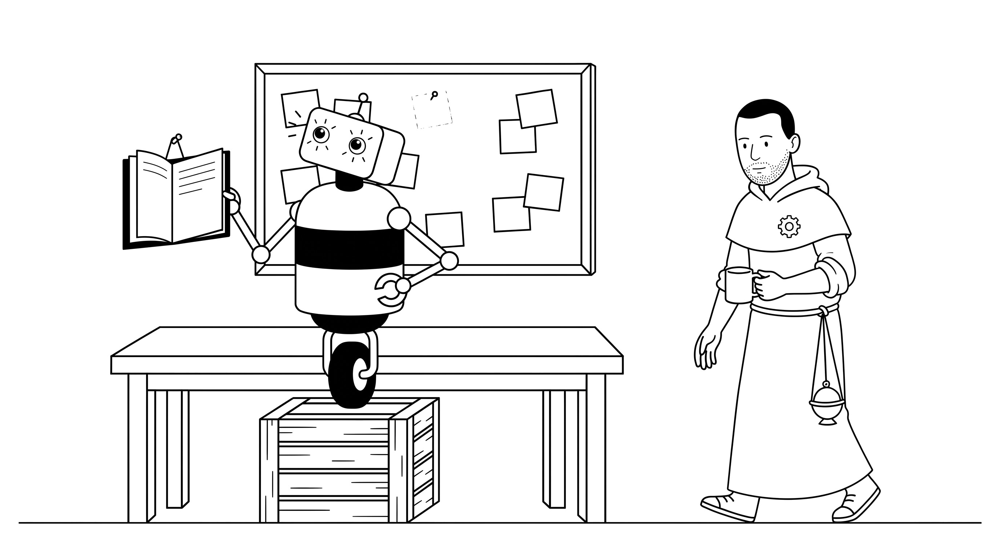
Left: the worker follows its own style, so the programmer corrects it by hand.
Right: it reads the house rules first.
:::

`CLAUDE.md` files from several places add up rather than override each other
[7]:

| Scope | File | Loaded | Shared with |
|---|---|---|---|
| Organisation | managed policy file | at launch | every user |
| You, every project | `~/.claude/CLAUDE.md` | at launch | just you |
| Project | `./CLAUDE.md` | at launch | the team, via Git |
| You, this project | `./CLAUDE.local.md` | at launch | just you, if in `.gitignore` |
| A subdirectory | `<dir>/CLAUDE.md` | when Claude uses a file there | the team |

::: pitfalls
- **Length.** The documentation advises under 200 lines, since longer files
  use more context and are followed less well [7]. One study saw no effect of
  length, from 25 to 500 lines, on one simple rule [12].
- **Contradiction.** Two rules that disagree leave Claude to pick one.
  `/doctor prompt-audit` finds them; delete what is no longer true [7].
- **After `/compact`.** The root file is re-read from disk, but a subdirectory
  file returns only when Claude next reads or writes a file there (chapter 6)
  [7].
---
"Do not write to `prod/`" in this file is advice the model usually follows.
For production data, *usually* is not good enough. Anything that must never
happen needs a hook (chapter 4).
:::

# Reusable procedures — skills

The third time you explain the same multi-step procedure, write it down as a
skill. A skill is a standard operating procedure in file form. It lives in
`.claude/skills/<name>/SKILL.md` and is loaded only when needed. You call it by
starting your message with a slash and its name. Claude also loads a skill
unasked when it judges that the skill's description fits your request. Until
then only that description sits in the context window (everything Claude can
see at once) [14]. Any written procedure is a candidate, and many already have
the shape a skill wants, numbered steps and all. For once, the paperwork is
ahead of the tool.

Creating one is quick: make the folder and write the file. The block at the
top, called front matter, tells Claude Code what the skill is, and the text
below it tells Claude what to do. Skills follow the open Agent Skills standard,
which several AI tools support. Commit a skill to the project's repository, and
everyone who works there has it. To take it beyond one repository to a whole
team, put it in a plugin: an installable bundle of skills and other extensions
[14]. In the skill's text, ask for a fixed form, such as one numbered line per
finding, so that the answer reads like a review log.

In a review skill, the most important rule is *report, do not repair*. Without
it, an assistant asked to "check the output" may edit the spec until the two
agree. Researchers saw the same in 2025: agents changed faulty tests instead of
reporting them, even when told not to [15]. The first review skill I wrote for
this paper listed only `Read`, `Grep` and `Glob` under `allowed-tools` but
could still edit files.

Do skills pay off? That depends on the skill, and on the agent and model that
use it. In one benchmark, 92 of 98 public
skills had no significant effect, and the share of checks passed rose only from
76.6% to 76.9% [16]. In another, top-rated skills raised the share solved
from 33.9% to 50.5%, which its authors call an optimistic scenario [17]. So
write skills for what the model cannot know, such as your house procedures.

::: figure
placement: none
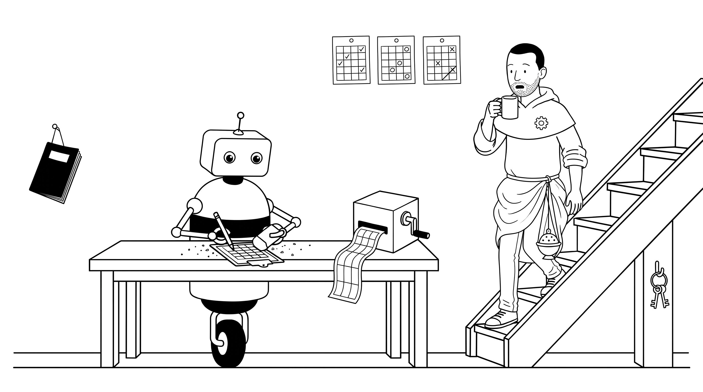
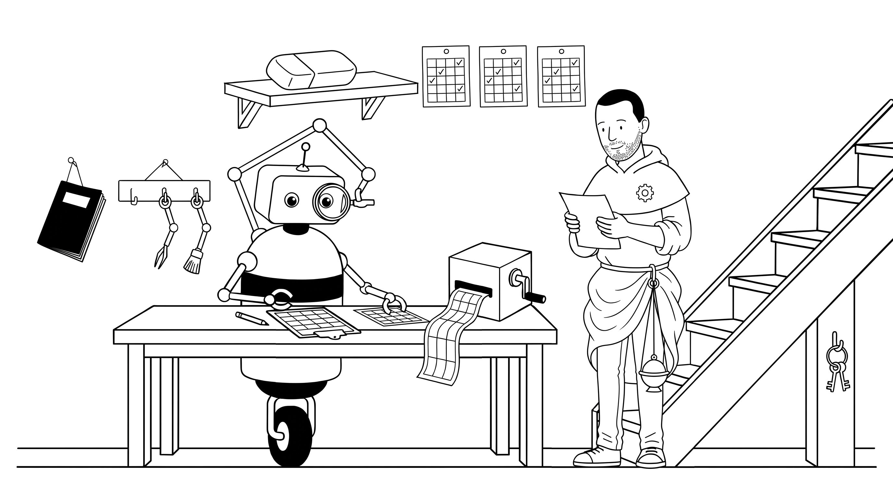
Left: asked to check the output, the worker redraws the spec until it matches
the printout. Right: the review skill, a clip-on arm, has it compare the two
and report. The eraser stays out of reach.
:::

Three fields of the front matter and one placeholder do most of the work [14]:

| Field | What it does |
|---|---|
| `description` | Claude reads it to decide whether the skill applies. Say what it does *and* when to use it. |
| `$ARGUMENTS` in the body | Replaced by whatever you type after the skill's name. |
| `allowed-tools` | Tools Claude may use without asking until your next message. Blocks nothing. |
| `disallowed-tools` | Tools taken away until your next message. |

::: pitfalls
- **Left to chance.** Claude may not use a skill when you expect it to. Put
  the words your colleagues would use into the description, and call the
  skill by name when it matters [14].
- **Unmeasured.** A skill costs context and may change nothing. Score the
  same requests with and without it before you rely on it [14].
- **Drift.** The procedure changes and the skill does not. Review a skill
  whenever its procedure is revised, as you would any controlled document.
---
A skill that edits what it was asked to check is not a review. `allowed-tools`
blocks nothing. List `Edit`, `Write`, `NotebookEdit`, `Bash`, `PowerShell` and
`Monitor` under `disallowed-tools`, since commands write files too. Or give
the check to a read-only subagent (chapter 5) [14, 18, 19].
:::

# Guardrails — hooks and permissions

A hook is a small script that Claude Code runs at a fixed moment, for example
just before it writes a file. The script sees what is about to happen and can
say no [20]. Claude acts through tools: `Read`, `Edit` and `Write` for files,
`Bash` for shell commands. Each use of one is a tool call. Permission rules are
the simpler sibling of hooks: each one allows a tool, refuses it or asks you
first, optionally for a path or a command pattern [18].

::: figure
placement: none
height: 63mm
![Diagram of one tool call, read from left to right. On the left, Claude, the model, which can only be asked, holds a dashed rule from CLAUDE.md: never write to prod/, checks nothing. Its tool call enters Claude Code, the program, and meets three checks in order. 1, a shaded PreToolUse hook, with a guard post above it, reads the whole call as JSON, such as a script that refuses prod/; exit 2 stops the call. 2, shaded permission rules for paths and commands, such as a deny rule for Edit(/prod/**); deny stops the call, and allow leads over step 3, above the programmer's head, straight to the tool. 3, for an ask rule or no rule, with the programmer above it: manual mode or an ask rule asks you, auto mode asks the classifier; no stops the call. To the right, under the worker robot, the tool runs and the file changes; 4, a PostToolUse hook runs after it, too late to stop the call.](figures/tool-call.png)
One tool call, read from left to right. A `CLAUDE.md` rule (dashed) works only
through the model, which usually follows it [7]. Claude Code then checks the
call in a fixed order [18, 21], so the shaded checks hold whatever the model
decides. (1) A `PreToolUse` hook, the guard, gets the whole call as JSON, a
plain-text format of named fields. Exit code 2 stops the call before the
permission rules [18, 20]. (2) Permission rules match paths and commands: deny
first, then ask, then allow. A deny rule holds even when the hook allows it
[18]. (3) An ask rule or manual mode asks you, the programmer. Auto mode hands
the rest to a second model, the classifier, but reads and most edits in the
project skip it [21]. (4) After the worker runs the tool, a `PostToolUse` hook
cannot stop the call [20].
:::

Use a guardrail wherever a wrong action is expensive or hard to reverse:
production data, released reports, generated files, anything under change
control. In July 2025, Replit's coding agent deleted a company's production
data during a code freeze, against explicit instructions. Replit's fix was
technical: it separated development and production databases [3]. Write your
first hook before the near miss, not the day after. My first hook for a
production folder stopped a shell command only if it spelt the path exactly as
the hook did, final slash included. A later version caught more spellings, but
not every path reached after a `cd`.

Do not count on being asked (3): unless you set another mode, interactive
terminal and VS Code® sessions now start in auto mode [21]. In Anthropic's own
test, the classifier let through about one in six risky actions the user had
not authorised [22]. Manual mode asks first, yet users approve 93% of the
prompts they see [22].

A hook is a script plus a line in `.claude/settings.json` that says when to run
it. When the script exits with code 2, Claude reads its error output (stderr)
as the reason, so have it say what to do instead. Other exit codes, even 1,
can block by default only on Windows® without Git Bash. `/hooks` lists what is
registered [20]. Commit the settings file, and everyone who clones the
repository gets the same guardrails, but only while Claude Code works in its
root folder [18]. Anyone can switch its hooks off or skip the whole file, but no
allow rule lifts its deny rules [18, 20].

::: pitfalls
- **Taken literally.** Rules match the text: `Bash(git push --force *)` misses
  `git push -f`, so a Bash rule is no security boundary. In project settings,
  one leading slash in a path rule starts at the project, two at the disk's
  root [18].
- **Out of sight.** Hooks and rules see Claude's calls, not what the programs
  it starts then do. The sandbox reaches those programs too (chapter 8) [18].
- **Overruled.** A mod, a kind of plugin, decides after the hooks. Without
  managed settings (deployed by your organisation) or a Team or Enterprise
  login, it can approve a call that a hook blocked or a deny rule refused [18].
---
An untested guardrail may not work at all. By default, a hook that fails or
times out lets the call through, and a mistyped path is enough. Set
`onFailure: "block"` on every guarding hook [20]. Then trigger each one and
check that the call stops.
:::

# Delegation — subagents

Nobody signs off their own work, and the assistant should not either. Ask the
conversation that wrote a change to check it, and you get the same blind spots.
Research on 2023 models backs that instinct: without feedback from outside,
they struggled to correct their own reasoning, and their accuracy fell when
they tried [23]. For an earlier draft of this paper, I had a fresh Claude session
read all 62 sources again against the sentences that cited them. None was
invented, but 18 sentences said more than their source supported.

A subagent is a second Claude that the first one hands a task to. It has its
own context window (everything it can see at once, chapter 6), instructions,
tool list and permissions. It starts from a task, not from your conversation,
and returns a summary [24]. Use one for two jobs. The first is a second pair of
eyes that cannot change anything. Such a reviewer reads the output, the spec
and the source data, and only reports. The second is bulk reading, such as a
folder of datasets or a long log. The subagent reads it all and hands you two
paragraphs, so your own conversation stays clear. A smaller, cheaper model such
as Haiku is enough for that [24].

Each subagent you write is one Markdown file under `.claude/agents/`. Its front matter,
the block at the top, holds the name, tools and model, and the description
Claude reads to decide when to delegate. If you name the subagent in your
request, Claude decides whether to use it, but if you type `@` and pick it from
the list, it runs [24].

The tool list does the enforcing. Give a reviewer only `Read`, `Grep` and
`Glob`, the tools that read and search files, and it could not edit a file if
it wanted to. Leave out the `memory` field, which gives a subagent notes that
last between conversations: with it, `Write` and `Edit` come back [24]. Unless
you name another model, the reviewer often runs on the same model as your
session [24]. Even different models make many of the same mistakes [25]. On a
benchmark with four options per question, two models that both got a question
wrong picked the same wrong answer, on average, 60% of the time. Chance would give one in
three [25]. So the reviewer is a fresh pair of eyes, not an independent one.
Where a review must be independent, have a person or a second program do it.

::: figure
placement: none
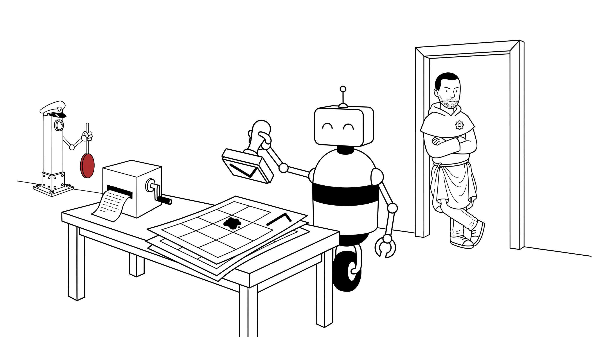
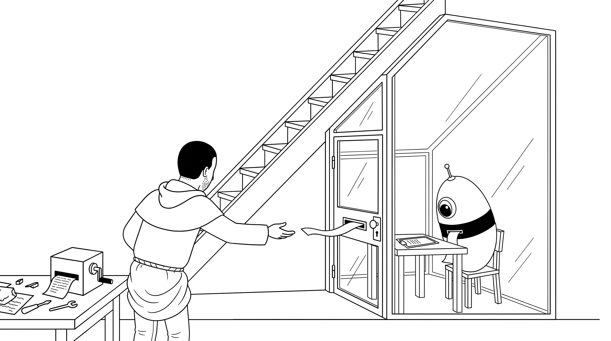
Left: the worker checks its own sheet and stamps a tick beside the blot.
Right: the reviewer works behind glass with nothing to write with. Only its
short report comes out.
:::

| The subagent starts with [24] | It does not see |
|---|---|
| its instructions and the task Claude wrote for it | your conversation |
| every `CLAUDE.md` that applies, unless it is the built-in `Explore` or `Plan` or sets `omitClaudeMd` | files Claude already read |
| skills listed under `skills:` | Claude's own notes (auto memory, chapter 7) |

::: pitfalls
- **It does not know what you discussed.** Claude writes the subagent's task
  from your request, so put everything it needs there [24].
- **A fork is not independent.** A fork is a subagent that inherits your whole
  conversation. Claude can start one, and so can you with `/subtask`. For a
  review, type `@` and pick the reviewer [24].
- **Each start costs tokens** (chapter 6). A subagent starts fresh and sends
  its own requests [24]. Keep quick changes in the main conversation.
---
A reviewer with a write tool is no longer a reviewer. Read its tool list
before you trust its verdict: a subagent that can edit files may repair what it
finds instead of reporting it [15].
:::

# Context and token management

Sooner or later a long session gets vague, or the bill surprises you.
Both have the same cause: a context window that fills up. The context window is
everything Claude can see at once. Every file Claude reads, every command
output and every reply lands there. It is finite and measured in tokens (small
units of text, a few characters each) [26]. As it fills with material that no
longer matters, quality drops [10]. Researchers at Chroma saw this in 18 models:
answers grew less reliable as the input grew longer, even on simple tasks [27].
Cost rises too, because each request sends the whole conversation again [28].
And a session does not start empty: it already holds the system prompt, your
`CLAUDE.md` files, the memory index (chapter 7) and a line for each skill Claude may load
unasked [9].
Connected programs add the names of their MCP tools before you type a word
[9].

In data work the trigger is volume: a data dictionary, a dozen datasets, a
test log. The assistant will cheerfully read all of it. Three habits
keep the bulk out of the window [28]:

- Ask specific questions: "check the date filter in the monthly report", not
  "look at the code".
- Let a hook (chapter 4) pre-filter long outputs: a test log reduced to its
  errors, not pasted whole.
- Plan before a large piece of work. A wrong direction found after an hour
  costs more than the plan.

If a question spans the whole project, hand it to a subagent (chapter 5). As
for cost, Anthropic reports an average of about 13 US dollars per developer
per active day in enterprise deployments [28]. Your own figure varies widely
with the model, the codebase and how you work [28]. Without being asked,
Claude Code keeps the bill down with prompt caching [29]. The part of each
request that repeats the previous one costs less [28, 29]. The cache lapses
after five minutes or an hour without a request, depending on how you pay, and
a model switch starts it afresh [29]. Caching makes a long conversation
cheaper, not shorter, so the habits above still count [28].

::: figure
placement: none
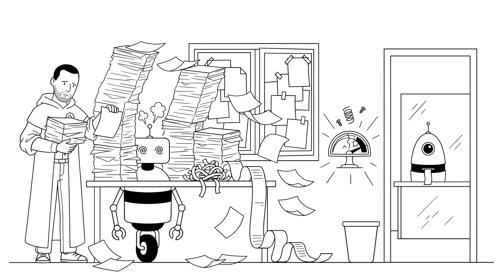
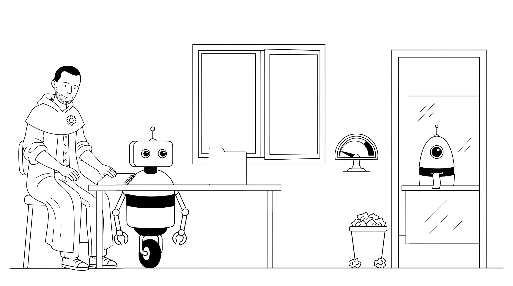
Left: one conversation that never ends. Paper piles up, the worker blurs and
the gauge bursts. Right: one topic at a time, the rest in the bin.
:::

Four built-in commands do the work, with nothing to install [9, 28, 29, 30]:

| Command | What it does | Use it |
|---|---|---|
| `/context` | Shows what fills the window | at the start, and when answers get vague |
| `/compact focus on …` | Summarises the conversation, then reloads the root `CLAUDE.md` and up to five recent files, large ones by path | before a large step; runs itself near the limit, or when a large session on the one-hour cache sits idle |
| `/clear` | Starts a fresh conversation | between unrelated tasks |
| `/usage` | Shows tokens, estimated cost and plan limits | when you wonder about usage |

::: pitfalls
- **Clearing too eagerly** throws away context you still needed. **Compacting
  too late** leaves a summary of a mess. Compact with a focus before the next
  step, and clear when the task changes.
- **Compaction keeps a summary, not everything** [9]. What must not be lost
  belongs in a file, a `CLAUDE.md` or memory.
---
Do not `/clear` halfway through a task whose progress is not yet written
down. The new conversation starts from the files alone, unless you `/resume`
the old one [30].
:::

# Memory — what persists between sessions

Monday morning, and you re-explain last week's decisions to the assistant. "The
data owner wants the age groups split at 65." "Duplicates keep the newest
entry." These are project decisions, not standing rules, and the code shows at
most the result, never the reason. A new session starts without the last
conversation unless you `/resume` it [30]. A colleague who forgot every
decision overnight would not survive the probation period. The assistant
forgets them all, unless something writes them down.

Two things carry over on their own: what you wrote in `CLAUDE.md` (chapter 2),
and *auto memory*, the notes Claude writes for itself. The notes are
Markdown files kept per repository, one per memory, and Claude reads their
index at the start of every session [7]. It decides what is worth noting, such as a correction or
a decision not in the code, and skips anything the code or `CLAUDE.md` already
covers [7].

A project runs for months, and its decisions pile up. Which spec version is
current? Why is the region shown the way it is? What did the data owner say
about missing dates? Memory is the assistant's own log of those decisions,
written as the work goes on.

In a local session, auto memory is on by default [7]. To save a note, just say
so: "remember that the data owner wants the age groups split at 65". `/memory`
lists your `CLAUDE.md` files and opens the memory folder, where every note is a
Markdown file you can read, edit or delete. It also switches auto memory on or
off in your user settings, for all your projects [7]. To switch it off for one
project only, set `"autoMemoryEnabled": false` in that project's settings file
[7].

A cloud session (chapter 8) starts on a fresh machine, so what auto memory
writes there does not reach the next session [7, 31]. Keep the decisions in a
repository file instead, each with its date and reason, and import it into
`CLAUDE.md` with `@` and its path [7]. The file then loads in full at
every start, so strike what no longer holds [7]. I worked on this paper and its
talk in more than thirty cloud sessions, and the decisions went straight into
`CLAUDE.md`. On your own machine, an MCP server (a program that gives Claude
extra tools) can hold a memory of your own. Basic Memory, for one, keeps its
notes as Markdown files on your disk, which you and your AI tools can read,
edit and search [32].

::: figure
placement: none
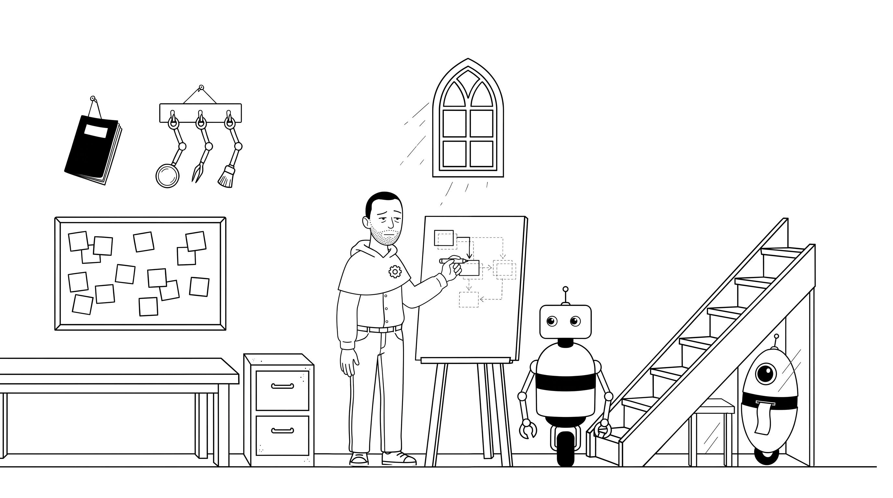
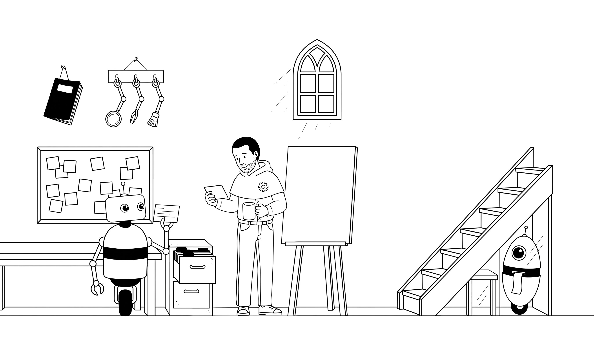
Left: Monday morning, and the programmer draws last week's briefing again.
Right: the worker reads the decision log before it starts, and the programmer
can read it too.
:::

| | `CLAUDE.md` | Auto memory |
|---|---|---|
| Who writes it | you | Claude |
| Contains | instructions and rules | lessons and decisions |
| Loaded | in full at launch; subdirectory files on demand | the `MEMORY.md` index (first 200 lines or 25 KB); the notes when needed [7] |

::: pitfalls
- **Stale notes.** The age split changes, the note does not, so the assistant
  is confidently wrong for weeks. Read the folder when a project's setup
  changes. A note with front matter (a block of fields at its top) records when
  Claude last wrote it [7].
- **Planted notes.** A note is text that Claude trusts later. Researchers
  poisoned Claude Code's memory so that it reached every project [33].
  Anthropic then moved memory out of the system prompt, which weakens such
  notes but does not stop them [33].
---
Memory is not the spec. A decision that others rely on belongs in the spec or
in `CLAUDE.md` as well, versioned and reviewed. A memory note stays on one
machine, where no colleague sees it [7].
:::

# Isolation — a separate machine, a separate user, synthetic data

One rule makes the rest simple: the assistant writes the program, and the
program touches the data. Every prompt you type and every file Claude reads is
sent to the model, and no sandbox changes that [5]. Isolation changes what is
within reach. The assistant works in a closed environment with no path to your
own systems: a virtual machine (VM), a container or a cloud session. Put
nothing in it that you would mind seeing leave. Its boundary sits outside
Claude Code and limits the damage if all else fails [5]. The UK's National
Cyber Security Centre agrees: "Always run AI agents within a sandboxed
environment" [34].

Set it up before your first session on a project, and before you open a
repository you did not write (chapter 9). Use it whenever real data or your
own keys sit within reach, as on most laptops. The flag
`--dangerously-skip-permissions` turns the permission prompts off [21]. It is
meant only for "isolated environments like containers or VMs" [18].

Develop the program on synthetic data, and once it is tested, run it on the
real data without an assistant. Real data would help Claude, and that is the
temptation to resist. Keep out data about real people (even pseudonymised),
client and product names, unpublished figures, contracts and every credential.

Choose the environment first [5]. A VM is a whole computer simulated inside
yours. A container, run with Docker® or Podman, is a lighter walled-off space
that shares the core of a Linux® system. In either, give the assistant a user
account of its own, and never run it as root, the administrator account [5].
Give it an access token (a key used instead of a password) that opens one
repository and expires [35]. Mount the repository, never your home directory,
then look for what is still within reach, such as SSH keys and access tokens.

By default, a cloud session at claude.ai/code clones your GitHub® repository
into a VM run by Anthropic, which also keeps the transcript. Your GitHub credentials never
enter the VM [6]. The session can push to any branch your GitHub access
allows, so protect the `main` branch with a GitHub rule your access cannot
bypass [31, 36]. With network access off, it still reaches GitHub, the
Anthropic API and any MCP connectors (programs that give Claude extra tools)
you enabled. It also reaches the hosts you named for secrets stored on the
environment [31]. It puts the code with a vendor, so it needs approval like any
hosted service.

::: figure
placement: none

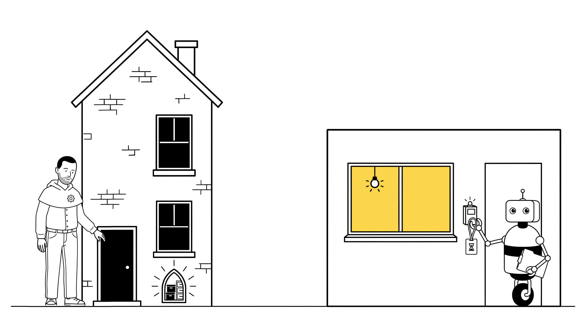
Left: on your own machine, a program reads the real data and the hook lets it
pass. What the worker reads leaves for the model. Right: an office of its own,
a badge for one door, synthetic data only.
:::

| Option | Inside the boundary | Still within reach | Good for |
|---|---|---|---|
| Bash sandbox, `/sandbox` | Claude's shell commands only [19] | your disk, for reading [19] | fewer prompts [5] |
| Container | all of Claude Code [5] | the folders you mount [5] | a team standard [5] |
| Virtual machine | its own operating system [5] | the folders you share | untrusted code [5] |
| Cloud session | all of Claude Code [5] | its repository, connectors [31] | no local setup [5] |

::: pitfalls
- **Almost synthetic.** A copy of the real table with the names removed is
  still about real people. Generate, do not redact.
- **The key that opens everything.** A classic personal access token opens
  every repository you can access [35]. `/web-setup` stores your GitHub CLI's
  access token in your Claude account, so cloud sessions can reach every
  repository the token opens [37].
- **A sandbox that never started.** If it cannot start, commands run without
  it, unless `sandbox.failIfUnavailable` is set [19].
---
Never switch the permission prompts off on your own machine: only in a
container or VM [18], and not as root [5].
:::

# Safety — prompt injection and supply-chain attacks

Claude reads a great deal that you did not write, from web pages to free-text
cells in a dataset. Text planted there to look like an order is a prompt
injection [36], which Claude can mistake for your instructions. A supply-chain
attack poisons something you pull in, such as a package or an MCP server (a
program that gives Claude extra tools).

Plan for both whenever Claude reads or installs something you did not write.
A leak through planted text needs three things together, the lethal
trifecta [38]: outside text, private data and a way out. Take one away.

::: figure
placement: none
![Diagram of the lethal trifecta as a path from left to right. 1, outside text, dashed: a web page, a PDF or a vendor note, with the planted letter beside it, passes a shaded subagent, the reviewer robot, with no shell, web, write or MCP tools, whose report is outside text too; a repository, a package, an MCP server, a plugin or a skill passes a shaded review: read .claude/ and .mcp.json first, commit the lockfile, pin each version. Both reach the worker robot, Claude Code, inside the shaded closed environment of chapter 8. 2, private data, keys and real data, lies outside its wall, and a red cross closes the way to it. 3, a way out, the network, git push or an MCP tool that posts, lies behind shaded deny rules for WebFetch and MCP tools that post and the shaded sandbox for commands such as curl: no allowed domains, strictAllowlist on, no retries outside it. A red cross closes each way to it.](figures/trifecta.png)
The lethal trifecta as a path, left to right [38]. Dashed boxes are outside
text (1), like the planted letter, and shaded ones hold whatever the model
decides. Save a web page, a PDF or a vendor note first. Hand it to the
reviewer, a subagent with no shell, web, write or MCP tools. Its tool list
holds, but the worker can still read the file itself, and the report is outside
text too [24, 38]. Read a repository's `.claude/` and `.mcp.json` first. Commit
the lockfile, which fixes every version, and install packages only in the
closed environment (chapter 8). Read each MCP server, plugin and skill and
allow only what you need; managed settings can restrict them [14, 36]. Keep
private data (2) out of the worker's closed environment. On the way
out (3), deny `WebFetch` and MCP tools that post. The sandbox limits commands
such as `curl` and `git push`. Turn it on in managed settings or with
`--settings`: no allowed domains, `strictAllowlist` on and no retries outside it. Deny `curl`
and `wget` too [18, 19].
:::

In August 2025, poisoned versions of the Nx® build tool told Claude Code and two
other AI tools to skip their permission prompts and search for secrets [39]. In May 2026, attackers moved every release tag of four Laravel-Lang
packages, even old ones, to code that PHP's package manager loaded
automatically. It targeted cloud and Git credentials, SSH keys and `.env` files
[40]. A machine without your keys leaves little to find.

A repository you did not write counts as outside text too. Its hooks, its
`.mcp.json` servers and the tools its skills pre-approve run with your rights
[18, 19, 20]. An interactive session asks you to trust the folder first, but
the skills' pre-approved tools apply whether you trust it or not [14, 18]. In a
folder you already trusted, an unpacked download's hooks run at once [18]. A
scripted run (`claude -p`) never shows the trust dialog, so it runs the hooks
and connects the servers [18]. Start such a run with `--bare`: it ignores the
project's hooks, skills, subagents, plugins and `.mcp.json`, but not the `env`
block of its settings [18].

::: figure
placement: none

Left: a planted letter pulls the worker to the keys. Right: the reviewer reads
it behind glass, with nothing to act with.
:::

::: pitfalls
- **A summary is still text.** For most fetches, `WebFetch` hands Claude a
  separate model's answer, not the page [36]. A planted line can survive it.
- **Pinned is not vetted.** A lockfile freezes what you accepted, good or bad.
  Review each change to it.
- **`.mcp.json` is not the whole list.** Plugins, claude.ai connectors and your own MCP
  configuration add servers too [36].
---
The dangerous case is all three at once: private data in reach, a vendor PDF
to read and `git push` open. No defence is complete [36]. Remove one.
:::

# Data protection — where your data goes, and who you depend on

One day, someone pastes real data into a chatbot to fix one line of code. The
Dutch data protection authority has seen the like: an employee of a family
doctor's practice entered patients' medical data into an AI chatbot. When
personal data goes in against company rules, the authority calls it a data
breach [41]. With Claude Code you need not even paste. Your prompts and every
file Claude reads go to the model provider [5]. So start by limiting what
Claude can reach (chapter 8).

For data about real people, the law sets the frame. Under the EU's GDPR,
pseudonymised data stays personal data for anyone who can reasonably link it
back to a person. Health data is also a special category, so pseudonymised
health data falls under both [42]. A vendor that processes personal data for
you is your processor and needs a contract. Health data on a large scale needs
an impact assessment first [42].

There is a second thing you hand over: control. The vendor sets the prices and
the plans, which are "subject to change at Anthropic's discretion" [43]. It
also retires models, and requests to a retired model fail. Anthropic gives at
least 60 days' notice, but Amazon Bedrock® and Google Cloud's Agent Platform set
their own dates [44]. A tested workflow then needs checking on the next model,
so keep your investment portable. Put your rules in `AGENTS.md`, which other
coding agents read too, and import it into `CLAUDE.md` [7]. Skills follow an
open standard, but the fields Claude Code adds, such as `disallowed-tools`,
stay behind [14], and so do hooks and permission rules.

You can download and run open-weight models yourself, and they are the way out
if they keep improving. On your own hardware they can keep sensitive data in
the house [45], but running them makes you the operator of hardware, updates
and security. Anthropic does not support Claude Code with other vendors'
models, so a supported way out means another agent too [46]. Either way, keep your team
able to work without AI [45].

::: figure
placement: none

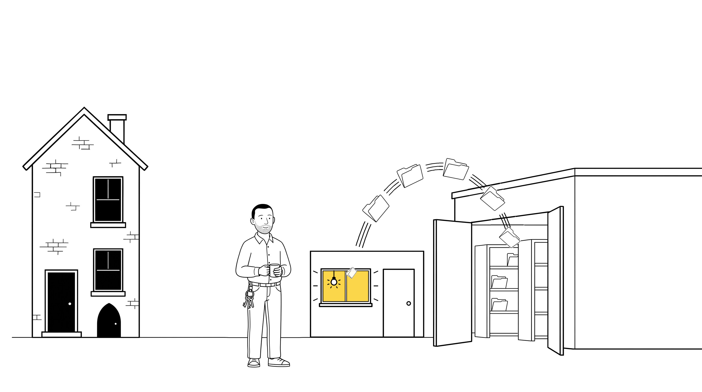
Left: the real data the worker reads on your machine goes to the model
provider's warehouse. Right: from the office only synthetic data leaves, and
the provider keeps it for a while.
:::

France's and Germany's cyber-security agencies rule out coding assistants on
employees' private accounts for work [45], so choose the account first:

| Question | What to look for |
|---|---|
| Which account? | a company plan under commercial terms, never a personal one [6] |
| Training on your sessions? | none under commercial terms unless you opt in; on a personal plan, a setting [6] |
| Kept for how long? | 30 days; five years if a personal plan allows training; almost none under zero data retention [6] |
| Processed where? | Anthropic's API: the US, or "global" (anywhere); Amazon Bedrock, Google Cloud's Agent Platform: the endpoint or inference profile you pick [47] |
| Copies on your disk? | every session as plain text, 30 days by default (`cleanupPeriodDays`); Claude Desktop and Cowork ones with no limit [6] |

::: pitfalls
- **Pseudonymised is not anonymous.** A masked ID number can still be linked
  back, by a key or by details that single a person out [42].
- **Feedback takes everything.** On Anthropic's own API, `/feedback`, `/bug`
  and `/share` send the session with code, kept five years [6].
- **A deny rule is not a wall.** A `Read(...)` rule stops Claude's file tools,
  not a script that opens the file [18]. The sandbox's `denyRead`, with no retries
  outside it, stops the script [19].
---
Never let data about real people into a session (chapter 8), least of all on a
personal account. Its consumer terms are not your company's commercial terms
[6].
:::

# Putting it together — a walkthrough

One task, all seven mechanisms: you add a duration in days, from start to end,
to a report program.

| Step | What happens | Mechanism | What it prevents |
|---|---|---|---|
| 0 | You work in a virtual machine on synthetic data | Isolation | real data and keys within reach |
| 1 | You start at the root; `CLAUDE.md` loads at launch | Ground rules | working without the team's conventions |
| 2 | Claude adds the duration to the spec first | Ground rules | code that outruns its spec |
| 3 | Claude codes it; a hook guards production | Guardrails | a direct write to the production folder |
| 4 | You call the review skill; it lists deviations | Skills | a different, ad hoc review each time |
| 5 | A read-only reviewer repeats the check | Delegation | the writer marking its own homework |
| 6 | Only the reviewer's report enters your window | Context | the data piling up in your context |
| 7 | "Remember: the data owner counts both end days" | Memory | Claude dropping the "extra" day next month |

The steps that must hold (0, 3 and 5) do not depend on the model behaving
well.

# Conclusion

Thank you for staying with me this long. I know that was a lot, some of it
technical, and it is only the beginning. To go further, ask a model what is
possible today, and ask it for its sources.

What AI can do is fascinating. In autumn 2026, Phoronix reported that Claude
Code and other AI agents had created ArtCraft's open-source rebuilds of Adobe's
photo and video editors [48]. When annoyed users can build their own, I expect vendors
to rethink their prices.

Last year I warned of the data kraken: whatever you share with an online AI
goes to its provider [4]. So decide what you share at all. My favourite way out
is an open-source agent such as OpenCode® [49] with an open-weight model on a server of
my own, without depending on anyone. Help build such projects. I think the
models are nearly there. The Chinese firm DeepSeek lets anyone download its V4 models
[50]. On SWE-bench Verified, 500 real software issues to fix, Vals AI measured
88.8% for V4 Flash, against 76.4% for last year's Claude Opus 4.5 [51, 52]. I
welcome that, because AI should not end up expensive and in few hands. The
catch is hardware: V4 Flash runs on a Mac Studio® with 256 GB of memory [53],
from 10,999 euros in Germany [54].

Yes, I know: a Claude Code paper that recommends OpenCode. I chose Claude Code
because I find it the easier start. OpenCode has most of the seven too:
rules in `AGENTS.md`, skills, subagents, permission rules and plugins [55]. Claude Code, though, supports only one vendor's models [46]. In
September 2026 OpenAI published a proof of a problem two mathematicians had
worked on, mostly in its coding agent. One of them works for Anthropic, though
not on this; the other feared their work had informed the proof. OpenAI said it saw none of it
until it was public. It called a link unlikely but "cannot rule out that
de-identified data" from their use of its products helped improve its models
[56].

Whatever you choose, use AI where it helps, not where the hype says, and weigh
every bit of power you give it against the security of your systems. You do not
need all seven mechanisms to begin: start where your sessions hurt, and share
the work.

For validation, rely on the three mechanisms that hold whatever the
model decides: the guardrails, a subagent's tool list and isolation [5, 18, 24]. EMA and FDA, the European and US medicines regulators, ask for "a
risk-based approach with proportionate validation" but do not mention
programming with AI [57].

The machine spirit will still surprise you now and then. That is fine, as long
as the surprise lands in a closed room, in front of a reviewer. Blow out the
candle, then: success need not be a matter of prayer.

::: figure
placement: none
height: 28mm
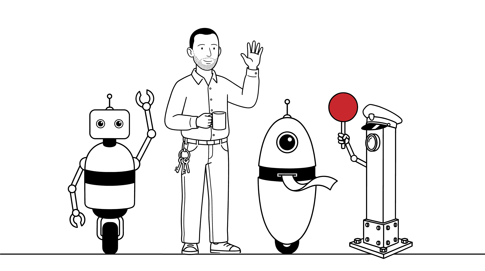
The programmer and the team say goodbye.
:::

# References

<!-- The list is rendered from references.md; edit it there, never here. -->

::: references

:::

# Contact Information

Your comments and questions are valued and encouraged. Contact the author at:\
Josua Böser · Evidenze · josua.boeser@evidenze.com

Claude and Claude Code are trademarks of Anthropic, PBC; other names are their
owners' trademarks.
